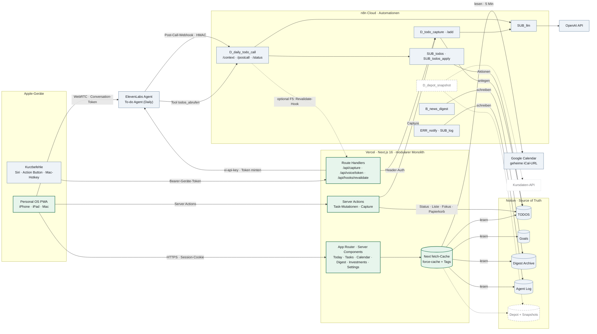
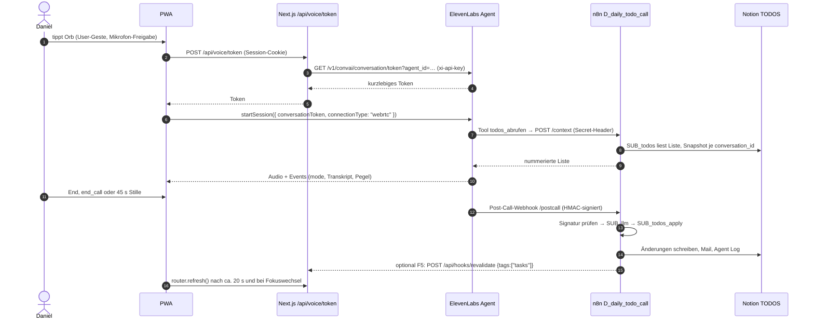

# Personal OS: Architektur- und Implementierungs-Blueprint

Stand 12.10.2026 · Status: **abgestimmt, Umsetzung läuft** (Umsetzungsstand siehe unten)
Grundlage: Design-Artefakt „Personal OS“ (7 Boards: Desktop hell/dunkel, iPhone hell/dunkel, iPad, Orb-Zustände, Design System), Live-Abgleich von Notion, n8n und ElevenLabs (nur lesend, nichts verändert), `claude/daily-todo-call-setup.md`.

**Belegstatus:** ✅ verifiziert (live geprüft oder aus Paketquelle) · 🔶 Annahme · 📊 Schätzung · ❓ vor Implementierung prüfen

## Umsetzungsstand (12.10.2026, nach Freigabe „lets go“)

| Bereich | Stand |
|---|---|
| F1 Notion `Fokus` (Checkbox) | ✅ angelegt |
| F3 ElevenLabs Aufbewahrung 30 Tage | ✅ gesetzt. `enable_auth` bewusst erst in Phase 2 (siehe E.3) |
| F2 n8n Header-Auth/HMAC | ✅ Header-Auth für `/add`, `/status`, `PA_orchestrator` (live). ⏳ HMAC `/postcall` braucht das ElevenLabs-Webhook-Secret; `/context` folgt in Phase 2 |
| F4 Notion-Integration „Personal OS Web“ | ✅ angelegt (API-Token), TODOS und Goals freigegeben |
| App-Gerüst, Login, Proxy, Env-Prüfung, Notion-/n8n-Client | ✅ |
| Tasks-Modul (Mapping, Regeln, Store, Actions), 28 Unit-Tests | ✅ |
| Today und Tasks nach Design (Desktop, iPad, iPhone, hell/dunkel), Quick Capture, Undo | ✅ im Demo-Modus geprüft |
| `/api/capture` (Siri/Mac), `/api/voice/token`, Voice-Testseite `/voice` | ✅ gebaut, live erst mit Secrets |
| PWA-Manifest, Icons | ✅ |
| Vercel-Projekt (Hobby), Secrets | ✅ live seit 13.10. Production-Branch = `claude/personal-os-architecture-nav59w` (GitHub-Default-Branch). Echte Notion-Aufgaben und Quick Capture von Daniel bestätigt |
| iPhone-Spike (Home-Bildschirm, `/voice` mit `ELEVENLABS_API_KEY`) | ✅ Voice im Home-Bildschirm-Modus von Daniel bestätigt (13.10.) |
| 4c Digest-Seite (Digest Archive, nur lesend), Digest in der iPhone-Tab-Leiste | ✅ gebaut (13.10.). Live, sobald „Digest Archive“ mit „Personal OS Web“ geteilt ist |
| 4a Kalender: iCloud (öffentlicher ICS-Link, nur lesend), Upcoming-Karte auf Today, Seite Tag/Woche, Refresh | ✅ gebaut (14.10.), siehe `docs/decisions/0001-icloud-kalender.md`. Live, sobald `ICLOUD_CALENDAR_URL` in Vercel steht. Google und Outlook entfallen vorerst |

**Korrekturen gegenüber dem ersten Entwurf** (durch die Umsetzung belegt):
- `use cache` hält Daten auf Vercel (Serverless) nur im Speicher einer Instanz ✅ (Next-16-Doku). Persistenter
  Server-Cache ist der `fetch`-Cache mit `force-cache` + Tags; er gilt laut Doku auch für POST-Anfragen wie die
  Notion-Query ✅, und `updateTag` invalidiert ihn ✅. Alle Cache-Stellen unten sind entsprechend zu lesen.
- `/context` prüft bereits einen Schlüssel (`X-Key`, If-Node „Zugang prüfen“), und `/postcall` ändert ohne
  gültigen Snapshot nichts ✅. S2 ist dadurch „Hoch“ statt „Kritisch“.
- Die ElevenLabs-Zugangsprüfung (`enable_auth`) darf erst an, wenn die Voice-Route der App live ist, sonst
  bricht der heutige Daily-Call über den Talk-to-Link.

---

## 0. Ist-Zustand: Befunde aus dem Live-Abgleich

Diese Punkte bestimmen die Architektur stärker als der Stack.

| # | Befund | Status | Konsequenz |
|---|---|---|---|
| B1 | TODOS hat `Titel`, `Liste` (Heute / Diese Woche / Broader Timeframe), `Prio` (Hoch/Mittel/Niedrig), `Status` (offen/erledigt, oft leer), `Datum`, `Erledigt am`, `Notizen`, `Person`, `Ziel` → Goals, `created_by`, `reschedule_count`. | ✅ | „Postponed 3ד ist sofort machbar. **Für Top 3 gibt es kein Feld**, für den Projekt-Chip ebenfalls nicht. |
| B2 | In n8n laufen 16 aktive Workflows, mehr als im Briefing: zusätzlich `SUB_todos`, `SUB_todos_apply`, `SUB_config`, `SUB_state`, `SUB_log`, `SUB_cost`, `PA_orchestrator`, `M_cockpit_status`, `M_improve`, `C_todos_hygiene`, `B_feedback`. | ✅ | Die Task-Logik für Voice existiert schon (`SUB_todos_apply`). Die Web-App baut keine zweite Voice- oder LLM-Logik. |
| B3 | Alle Webhooks (`/add`, `/status`, `/context`, `/postcall`) laufen mit „No credentials required“ und sind nur durch einen geheimen Pfadteil geschützt. | ✅ | Phase 0 ist Pflicht (siehe F). |
| B4 | Beim ElevenLabs-Agenten steht `enable_auth: false`, die Allowlist ist leer. Das Tool `todos_abrufen` sendet `X-Key` aus der dynamischen Variable `zugang`. Es sind keine Workspace-Secrets angelegt. Außerdem: `record_voice: true`, `retention_days: -1`, Limits 10 Gespräche/Tag, 1 parallel, 360 s, LLM `gpt-5.4-mini`. | ✅ | Jeder mit der Agent-ID kann Gespräche auf deine Kosten starten. Würde die Web-App `zugang` mitschicken, läge der Schlüssel im Browser. |
| B5 | `D_todo_capture` nimmt `POST {text, liste?}` an, macht über SUB_llm 1–5 To-dos daraus, legt sie in Notion an und antwortet `{ok, nachricht, anzahl, fallback}`. Laufzeit 4–6 s. | ✅ | Lässt sich unverändert als Capture-Backend für Web-App und Siri nutzen. |
| B6 | `B_news_digest` schreibt in Notion „Digest Archive“ (`Titel`, `Kernaussage`, `Themenfeld` KI/VC/Geopolitik/Wirtschaft, `Datum`, `Canonical URL`, `Source Count`). | ✅ | Der Digest im Dashboard ist reines Lesen. Ein neuer Workflow ist nicht nötig. |
| B7 | n8n-Last: 258 Ausführungen in 24 h, einschließlich Sub-Workflow-Läufe und Tests an einem Bau-Tag. | ✅ / ❓ | Ob Sub-Workflow-Läufe ins Cloud-Kontingent zählen, ist offen. **Die Web-App darf n8n deshalb nicht zum Lesen oder Pollen nutzen.** |
| B8 | Die Post-Call-Verarbeitung dauert 11–18 s (Executions 1044, 1059). | ✅ | Die App lädt nach Gesprächsende verzögert neu (oder per Revalidate-Hook, F5). |
| B9 | Goals (`Ziel`-Relation) sind Lebensziele mit Bereich und Ebene, keine Projekte. | ✅ | Der Chip zeigt in v1 den Goal-Titel. Ein eigenes Projektfeld ist optional. |

---

## A. Executive Architecture Recommendation

1. Eine einzige **Next.js-16-App** (App Router, TypeScript, Tailwind v4) auf **Vercel Hobby**, gebaut als modularer Monolith mit sechs Feature-Ordnern und ohne eigene Datenbank.
2. **Notion bleibt Source of Truth.** Die App liest TODOS, Goals, Digest Archive und Agent Log direkt über die Notion-API, mit einer eigenen, eng berechtigten Integration, und cached serverseitig im `fetch`-Cache mit Tags (persistiert auf Vercel).
3. **Einfache Task-Mutationen** (erledigen, verschieben, Fokus setzen, löschen mit Undo) schreibt die App über **Server Actions direkt nach Notion**: optimistisch, idempotent und ohne n8n-Ausführung.
4. **Alles mit Sprachverständnis bleibt in n8n.** Quick Capture läuft für Web und Siri über denselben gesicherten Endpunkt `/api/capture` → `D_todo_capture`, die Post-Call-Verarbeitung bleibt, wo sie ist. Die App selbst ruft kein LLM auf.
5. Der **Orb ist die Oberfläche des bestehenden ElevenLabs-Agenten** über `@elevenlabs/react` (WebRTC). Die App erzeugt nur kurzlebige Conversation-Tokens. Kontext und Post-Call laufen unverändert über n8n.
6. **Kalender:** Der öffentliche iCloud-Link (`ICLOUD_CALENDAR_URL`) wird serverseitig gelesen, für −14 bis +90 Tage expandiert und das Ergebnis 5 Minuten gecacht (umgesetzt 14.10., ADR 0001; ersetzt die ursprünglich geplante Google-iCal-URL).
7. **Investments bleiben Mock**, bis ein legaler Datenpfad steht. Empfehlung: Positionen manuell in Notion pflegen und den Kurs-Snapshot täglich über n8n holen.
8. **Apple-Integration als PWA** (Home-Bildschirm, Dock) plus **Kurzbefehle** für Siri, Action Button und einen globalen Mac-Hotkey. Keine native App in v1.
9. **Phase 0 kommt vor jeder neuen Funktion:** Agent-Auth aktivieren und die Webhooks per Header bzw. HMAC sichern. Das ist heute die größte Schwachstelle.
10. **Zusätzliche laufende Kosten:** €0 für Infrastruktur. Die einzige relevante Variable sind die Voice-Minuten, je nach Nutzung etwa €0–50 pro Monat (📊).

---

## B. Architekturdiagramm

### B.1 Komponenten und Datenflüsse



Legende: **blau = bestehend** · **grün = neu (Personal OS)** · **gestrichelt = geplant** · **gepunktet = optional**

### B.2 Voice-Gespräch (Ende-zu-Ende)



### B.3 Datenflüsse im Überblick

| # | Fluss | Weg | Latenz (📊) |
|---|---|---|---|
| 1 | Quick Capture → Dashboard | PWA → Server Action `captureText` → `lib/n8n.ts` → n8n `/add` (Header-Auth) → SUB_llm → Notion. Antwort `nachricht` als Toast, danach `updateTag('tasks')`. Siri und Mac gehen über `/api/capture` und dieselbe Funktion; dort `revalidateTag('tasks', { expire: 0 })`, weil `updateTag` nur in Server Actions erlaubt ist ✅. | 4–6 s (LLM) |
| 2 | Task-Änderung → Notion | PWA → `useOptimistic` → Server Action → Regeln (`rules.ts`) → `PATCH /v1/pages/{id}` → `updateTag('tasks')` | UI sofort, Notion 0,3–1 s |
| 3 | Voice → Notion | siehe B.2. Die App schreibt während des Gesprächs nichts. | Post-Call 11–18 s ✅ |
| 4 | Kalender → Dashboard | RSC → `getEvents()` (fetch-Cache, 5 Min, Tag `calendar`) → `fetch(GCAL_ICS_URL)` → parsen und expandieren | 0 ms aus dem Cache, beim Refresh 0,3–1 s |
| 5 | Investments (später) | n8n `D_depot_snapshot` täglich → Kurse × Positionen → Notion „Depot Snapshots“ → RSC `getPortfolio()` (Cache 1 h) | – |

---

## C. Feature Mapping

Spalte „Design“: was der Prototyp heute tut (**simuliert** = Timer/Mock im Prototyp). Spalte „v1“: was wir umsetzen.

### C.1 Shell und Navigation

| Element | Modul | Datenquelle | Automation | Design | v1 |
|---|---|---|---|---|---|
| Sidebar (Today, Tasks, Calendar, Digest, Investments, Settings) mit Badge „offene Heute“ | `shell` | TODOS (Zählung aus `getTasks`) | – | simuliert | echt |
| iPhone Floating Tab Bar (Today, Tasks, Calendar, Digest, Invest) | `shell` | – | – | statisch | echt. Settings über den Avatar |
| Kopfzeile: Datum, Begrüßung, „4 tasks left · Weldstone call at 11:00“ | `today` | TODOS + iCal | – | simuliert | echt (abgeleitet) |
| Sync-Chip „Synced“ | `shell` | Zeitstempel der letzten Notion-Abfrage | – | simuliert | echt: „Synced · vor 2 Min“ bzw. „Offline · Stand 10:42“ |
| Theme-Toggle, „Dark mode“, Settings-Appearance | `shell` | `localStorage` + `prefers-color-scheme` | – | lokal | echt |
| Toast mit Undo | `shell` | – | – | simuliert | echt. Undo = Seite aus dem Notion-Papierkorb zurückholen |
| Mini-Player „Return to conversation“ auf anderen Tabs | `voice` | SDK-Status | – | simuliert | echt (Provider im App-Layout) |
| Karten dimmen während eines Gesprächs | `voice` | SDK-Status | – | simuliert | echt (CSS-Klasse) |

### C.2 Today

| Element | Modul | Datenquelle | Automation | Design | v1 |
|---|---|---|---|---|---|
| Today's Focus (Top 3, „0 of 3“, Feedbacktext) | `tasks` | **neues** Feld `Fokus` (Checkbox, Freigabe F1) | – | simuliert | echt nach F1 |
| My Tasks: Tabs Today / This Week / Later mit Zählern | `tasks` | `Liste` | – | simuliert | echt |
| Task-Zeile: Checkbox, Titel, Chip | `tasks` | `Status`, `Titel`. Chip = Titel des verknüpften Goals | – | Projekt fiktiv | Goal-Titel (B9) |
| „Postponed 3× — keep, move or drop?“ | `tasks` | `reschedule_count ≥ 3` | – | simuliert | echt |
| Review-Modus (Complete / Keep / Reschedule / Top 3 / Delete) | `tasks` | TODOS | – | simuliert | echt, reine Client-Ansicht über dieselben Actions |
| Quick Capture (Shortcut-Hinweis, „Saving…“, „Saved to Notion“) | `capture` | → n8n `D_todo_capture` | SUB_llm | simuliert (1-s-Timer) | echt. Tastenkürzel nur in der App, global per Mac-Kurzbefehl |
| Assistant-Karte: Orb, Status-Chip, Headline, Subline | `voice` | ElevenLabs SDK | `/context`, `/postcall` | Skript | echt |
| Mikrofon stumm, Start/End, Transkript-Toggle mit Sprechblasen | `voice` | SDK `onMessage` | – | Skript | echt, nur live, wird nicht gespeichert |
| Upcoming: „NEXT · IN 36 MIN“, Timeline, aufklappbare Details | `calendar` | iCal | – | Mock | echt |
| Daily Progress Ring | `tasks` | TODOS (offen + heute erledigt) | – | simuliert | echt |
| Karte „Law 45“ mit Vor/Zurück | `today` | statische Liste im Code (48 Titel, Tag des Jahres) | – | lokal | echt, ohne Backend |
| Investments-Teaser (Werte verbergen, Sparkline, Allokation, „Demo data“) | `investments` | Mock-Modul | später `D_depot_snapshot` | Mock | Mock |

### C.3 Tasks, Calendar, Digest, Investments, Settings

| Element | Modul | Datenquelle | Automation | Design | v1 |
|---|---|---|---|---|---|
| Overview/List-Umschalter, Spalten Heute / Diese Woche / Broader mit „open“-Zähler | `tasks` | `Liste` | – | simuliert | echt |
| „Synced with Notion · TODOS · 2 min ago“ | `tasks` | Cache-Zeitstempel | – | simuliert | echt |
| „New task“ | `capture` | → n8n `/add` mit `liste` | SUB_llm | simuliert | öffnet Quick Capture mit vorbelegter Liste (ein einziger Anlegepfad) |
| Zeilenaktionen: Stern, Verschieben, Löschen, „Open in Notion“ | `tasks` | TODOS, `page.url` | – | simuliert | echt |
| Kalender Day/Week, Timeline 08–21 mit Jetzt-Linie | `calendar` | iCal | – | Mock | echt |
| Event-Detail (Zeit, Ort, Personen, Notizen) | `calendar` | `LOCATION`, `ATTENDEE`, `DESCRIPTION` | – | Mock | echt. Personen ❓ (enthält der Feed `ATTENDEE`?) |
| „Ask assistant to prepare“ | `voice` + `calendar` | Event → `sendContextualUpdate()` ✅ | – | simuliert | Phase 4, optional |
| Digest „For you“ (4 Hinweise) | `digest` | Regeln über TODOS, iCal und Agent Log | – | Mock (teils E-Mail-Inhalte) | regelbasiert. E-Mail-Signale entfallen |
| „The Daily Brief“ / „Markets & Money“ | `digest` | Digest Archive: jüngste Ausgabe (Tag, dann Lauf 08:00/17:00), nach `Source Count`. Erstes Themenfeld `Wirtschaft`/`VC` → Markets, Rest → Brief | B_news_digest | Mock | echt |
| „Read the brief“ / „Read more“ | `digest` | `Canonical URL` bzw. Notion-Ansicht | – | simuliert | echt |
| Investments-Seite: Gesamtwert (verbergen), Perioden 1M/3M/1Y/All, Chart, Allokation, Holdings | `investments` | Mock-Modul (Design-Daten) | – | Mock | Mock bis Phase 4b |
| Settings · Integrations-Status | `settings` | Notion-Abfragezeit, letzte Fehler im Agent Log, letzter iCal-Abruf, ElevenLabs-Konfiguration | – | Mock | echt (5 Min Cache) |
| Settings · Apple-devices-Hinweis | `settings` | statisch | – | statisch | echt |
| Orb-Zustände Idle / Listening / Thinking / Speaking, audioreaktiv, Reduced Motion | `voice` | SDK `status`, `mode`, `getInput/OutputVolume()` ✅ | – | simuliert | echt. „Thinking“ wird abgeleitet (siehe E.3) |

### C.4 Bewusste Vereinfachungen gegenüber dem Design

| Design | Problem | Vorschlag | Vorteil |
|---|---|---|---|
| Hotkey ⌘⇧Space für Quick Capture | Eine Web-App kann keinen systemweiten Hotkey registrieren. | In der App: ⌘K bzw. ⌘⇧Space nur bei Fokus. Global: macOS-Kurzbefehl „Notieren“ mit eigener Tastenkombination. | Global nutzbar, ohne native App |
| Projekt-Chip („Weldstone“, „Scalable“) | TODOS hat kein Projektfeld. | v1 zeigt den Goal-Titel aus der Relation `Ziel`. Später optional ein Select `Projekt` (Freigabe). | Keine Schemaänderung nötig |
| „For you“ mit E-Mail-Inhalten | Bräuchte Gmail-Zugriff und ein LLM. | Regelbasiert: Aufgaben ≥ 3× verschoben, Deadline ≤ 2 Tage, nächster Termin, n8n-Fehler der letzten 24 h. | 0 € und keine neue Integration |
| Assistent bucht Fokusblock, setzt Erinnerung (Demo-Skript) | Der Kalender ist nur lesbar. | Nicht im Scope. Der Agent darf das nicht versprechen. | Klare Grenze |
| Zustand „Thinking“ | Das SDK liefert nur `speaking` und `listening`. | Ableiten: zwischen finalem User-Transkript bzw. Tool-Request und Beginn von `speaking`. | Gleiche UX ohne Backend |
| „New task“ als eigener Anlegepfad | Zwei Wege, Aufgaben anzulegen, heißt doppelte Regeln. | Öffnet Quick Capture mit `liste`-Vorgabe. | Ein Pfad: Logging und Parsing bleiben konsistent |

---

## D. Repository-Struktur

**Annahme 🔶:** Die App entsteht in diesem Repo (`first-project-`). Ein späteres Umbenennen in `personal-os` ist optional und reversibel. Der bestehende Ordner `claude/` bleibt unverändert.

```
first-project-/
├─ CLAUDE.md                     Entwicklungsregeln für Claude Code (Entwurf in D.3)
├─ README.md                     Start, Env, Deploy in 10 Zeilen
├─ .env.example                  alle Variablen ohne Werte
├─ package.json                  Skripte: dev · build · check · test · e2e
├─ next.config.ts                cacheComponents, Security-Header, typedRoutes
├─ tsconfig.json · eslint.config.mjs · vitest.config.ts · playwright.config.ts
├─ claude/                       bestehend: Ops-Doku n8n/ElevenLabs, Kurzbefehle (unverändert)
├─ docs/
│  ├─ architecture/personal-os-blueprint.md   dieses Dokument
│  ├─ notion-contract.md         Property-Namen und Optionen = Vertrag mit n8n
│  ├─ integrations.md            n8n-Routen, ElevenLabs, Kurzbefehle, Env
│  └─ decisions/NNN-*.md         Kurz-ADRs (eine Seite) bei Architekturänderungen
├─ design/
│  └─ personal-os.html           Design-Artefakt als Referenz (Phase 0)
├─ public/                       Icons, apple-touch-icon, Splash
├─ src/
│  ├─ proxy.ts                   Next-16-Proxy (früher middleware): ohne Session → /login
│  ├─ app/
│  │  ├─ layout.tsx              Root: Fonts, Theme-Init-Script, Viewport/Safe-Area
│  │  ├─ manifest.ts             PWA-Manifest (Name, Icons, standalone, Farben)
│  │  ├─ globals.css             Tailwind v4 + Design-Tokens (hell/dunkel)
│  │  ├─ login/page.tsx · login/actions.ts
│  │  ├─ (app)/layout.tsx        App-Shell: Sidebar/TabBar, requireSession, VoiceRoot
│  │  ├─ (app)/page.tsx          Today
│  │  ├─ (app)/tasks/page.tsx
│  │  ├─ (app)/calendar/page.tsx
│  │  ├─ (app)/digest/page.tsx
│  │  ├─ (app)/investments/page.tsx
│  │  ├─ (app)/settings/page.tsx
│  │  └─ api/
│  │     ├─ capture/route.ts     Siri/Mac (Bearer) → captureToN8n()
│  │     ├─ voice/token/route.ts Session → ElevenLabs-Token
│  │     ├─ hooks/revalidate/route.ts   n8n → revalidateTag (optional F5)
│  │     └─ health/route.ts      Minimalstatus
│  ├─ features/
│  │  ├─ tasks/
│  │  │  ├─ types.ts             Task, TaskList, Priority
│  │  │  ├─ notion-map.ts        EINZIGE Stelle mit Notion-Property-Namen (Zod-geprüft)
│  │  │  ├─ store.ts             listTasks · patchTask · trash/restore (Notion oder Mock)
│  │  │  ├─ rules.ts             reine Geschäftsregeln (Top-3-Limit, nächste Liste, stale)
│  │  │  ├─ actions.ts           'use server': complete · reschedule · setFocus · trash · restore
│  │  │  └─ components/          FocusCard, TaskList, TaskRow, ReviewMode, ProgressRing
│  │  ├─ capture/                actions.ts · n8n-capture.ts · CaptureBar.tsx
│  │  ├─ voice/                  VoiceRoot (lazy Provider), Orb, useOrbState, Transcript, MiniPlayer
│  │  ├─ calendar/               ical.ts (fetch, parse, expand) · components/
│  │  ├─ digest/                 data.ts (Digest Archive) · for-you.ts (Regeln) · components/
│  │  ├─ investments/            mock.ts · components/ (SVG-Chart wie im Design)
│  │  └─ settings/               status.ts (Integrationsstatus) · components/
│  ├─ components/ui/             Card, Button, Segmented, Checkbox, Toast, Chip, Icon, Sheet
│  ├─ lib/
│  │  ├─ env.ts                  Zod-validierte Server-Env (import 'server-only')
│  │  ├─ auth.ts                 Session-Cookie (jose), requireSession, Passwortprüfung (scrypt)
│  │  ├─ action.ts               authedAction(schema, fn): Session + Zod + Fehlerform
│  │  ├─ notion.ts               dünner fetch-Client: Version-Header, Timeout, 429/529-Backoff
│  │  ├─ n8n.ts                  callN8n(path, body): Header-Auth, Timeout 15 s
│  │  ├─ cache-tags.ts           'tasks' | 'calendar' | 'digest' | 'goals' | 'status'
│  │  ├─ time.ts                 heute/jetzt immer in Europe/Berlin (Vercel läuft in UTC)
│  │  └─ log.ts                  strukturierte Logs ohne Inhalte
│  └─ mocks/                     Fixtures aus dem Design (TASKS, EVENTS, HOLD …)
└─ tests/
   ├─ unit/                      rules, notion-map, ical, auth, capture-route
   └─ e2e/smoke.spec.ts          Login → Today (Mock-Daten) → Task abhaken
```

### D.1 Verantwortlichkeiten und Architekturentscheidungen

| Frage aus dem Briefing | Entscheidung | Begründung |
|---|---|---|
| Repository-Interface pro Modul? | **Nein.** Pro Modul eine `store.ts` mit 3–5 Funktionen. Ein Mock/Notion-Schalter nur dort, wo wirklich zwei Implementierungen existieren (Tasks). | Nur eine echte Datenquelle. Die Naht ist `store.ts` + `notion-map.ts`. Ein Interface kommt erst, wenn eine zweite Quelle real wird. |
| Server Actions direkt? | **Ja, für alle UI-Mutationen.** Route Handlers nur für externe Aufrufer (Siri, n8n, Token). | Typisiert, kein eigener API-Layer, eingebauter Origin-Check. Laut Next-Doku sind Actions öffentliche POST-Endpunkte, deshalb `authedAction` als Pflicht-Wrapper. ✅ |
| Notion-Zugriffe kapseln? | `lib/notion.ts` (HTTP, Retry, Version) + `features/*/notion-map.ts` (Property-Namen, Zod-Parsing). | Wird eine Notion-Spalte umbenannt, ändert sich genau eine Datei. Kein SDK nötig, `fetch` genügt und ist cachebar. |
| Wo liegen Geschäftsregeln? | `features/tasks/rules.ts`, reine Funktionen mit Unit-Tests. | Testbar ohne Netzwerk. Die Actions orchestrieren nur. |
| Doppelte LLM-Logik vermeiden? | Kein LLM-SDK in `package.json`. NL-Parsing nur in n8n (SUB_llm), Gesprächs-LLM nur in ElevenLabs. | Eine Stelle pro Fähigkeit. Prompts bleiben in Notion „Prompts“. |
| Redundante Abfragen vermeiden? | Ein `listTasks()` pro Request (React `cache()`) und über Requests hinweg (fetch-Cache, Tag `tasks`). Focus, Tabs, Progress, Badge und Kopfzeile werden aus derselben Liste abgeleitet. Goal-Titel kommen aus einer gecachten Map (1 Abfrage/Tag), nicht pro Task. | Pro Seitenaufruf höchstens 1 Notion-Abfrage pro Datenquelle, kein N+1. |
| Server oder Client Components? | Seiten und Datenabruf sind RSC. Client-Inseln: TaskList (optimistisch), CaptureBar, Voice, Segmented Controls, Toast, Theme. | Kleines JS-Bundle. Tokens bleiben auf dem Server. |
| Doppelte Task-Logik Web vs. Voice? | Bewusst akzeptiert: Die Web-App setzt 5 einfache Mutationen direkt, `SUB_todos_apply` bleibt für Voice. Gemeinsamer Vertrag ist `docs/notion-contract.md`. | Die Alternative (alles über n8n) kostet pro Klick 0,5–2 s und eine Ausführung. Konsolidierung siehe J. |

### D.2 Kern-Datentyp

```ts
// features/tasks/types.ts (Entwurf)
type Task = {
  id: string; url: string; title: string;
  list: 'today' | 'week' | 'later';          // Liste: Heute | Diese Woche | Broader Timeframe
  priority: 'high' | 'medium' | 'low' | null; // Prio
  status: 'open' | 'done';                    // Status (leer = offen)
  focus: boolean;                             // Fokus (neu, Freigabe F1)
  deadline: string | null;                    // Datum
  doneAt: string | null;                      // Erledigt am
  postponed: number;                          // reschedule_count
  goal: { id: string; title: string } | null; // Ziel → Goals
  createdBy: 'user' | 'agent' | null;         // created_by
};
```

### D.3 Entwurf `CLAUDE.md` (angelegt als `/CLAUDE.md`; dort gilt die aktuelle Fassung)

```md
# Personal OS: Regeln für Claude Code

Stack: Next.js 16 (App Router, cacheComponents) · TypeScript strict · Tailwind v4 · Vercel.
Daten: Notion = Source of Truth. n8n = Automationen. ElevenLabs = Voice. Keine eigene DB.

## Befehle
npm run dev · npm run check (tsc + lint + vitest) · npm run e2e · vor jedem Commit: npm run check

## Architektur
- Code nach Modul: src/features/<modul>/{types,store,rules,actions,components}. Gemeinsames nur in lib/ und components/ui/.
- Notion-Property-Namen NUR in features/*/notion-map.ts. Vertrag: docs/notion-contract.md.
- UI-Mutationen = Server Actions über lib/action.ts (authedAction + Zod). Route Handlers nur für Siri, n8n und Voice-Token.
- Jede Page/Action/Route prüft zuerst die Session bzw. das Token. Cache-Funktionen (use cache) lesen nie cookies() und
  werden erst nach requireSession() aufgerufen, damit keine privaten Daten im statischen Shell landen.
- Cache-Tags nur aus lib/cache-tags.ts. Nach Mutation: updateTag(tag).
- Datum/Uhrzeit nur über lib/time.ts (Europe/Berlin). Vercel läuft in UTC.
- Kein LLM-SDK, keine neue Datenbank, kein neuer Dienst ohne ADR in docs/decisions/.
- Secrets nur in lib/env.ts (server-only). Nie NEXT_PUBLIC_ für Tokens.
- Logs: Event + IDs + Dauer. Nie Task-Titel, Transkripte, Tokens.

## Tabu ohne ausdrückliche Freigabe von Daniel
- n8n-Workflows, Notion-Schemas/Datenbanken, ElevenLabs-Agent/Tools ändern oder löschen. MCP-Zugriffe darauf nur lesend.

## Benennung
Dateien kebab-case, Komponenten PascalCase, Actions als Verben (completeTask). Domäne englisch im Code,
Notion-Werte deutsch nur in notion-map.ts (Heute → 'today').

## Tests
Unit: rules, notion-map (echte API-JSON-Fixtures), ical (RRULE/EXDATE/Zeitzone), auth. E2E: ein Smoke-Test im Mock-Modus.
```

---

## E. Integration Blueprint

### E.1 Notion

| Punkt | Festlegung |
|---|---|
| Zugang | **Neue interne Integration „Personal OS Web“** (Freigabe F4), nur mit Zugriff auf TODOS, Goals, Digest Archive und Agent Log. Capabilities: Read + Update content. Kein Anlegen neuer Seiten: das macht ausschließlich n8n. Getrennt vom n8n-Token, damit beide unabhängig rotierbar sind. |
| API-Version | `Notion-Version: 2025-09-03` (wie in n8n ✅), Abfragen über `POST /v1/data_sources/{id}/query` ✅ |
| Lesen TODOS | Eine Abfrage, `page_size: 100`, Paging über `has_more`. Filter: `(Status ≠ erledigt ODER Status leer) ODER Erledigt am = heute`. Sortierung: Liste, Prio, Erstellzeit. |
| Schreiben | `PATCH /v1/pages/{id}` mit absoluten Werten (idempotent). Löschen: `in_trash: true`, Undo: `in_trash: false` ❓ (Wiederherstellen per API im Spike testen). |
| Rate Limit | Im Schnitt 3 Requests/s pro Integration. Bei 429/529 `Retry-After` beachten, Backoff mit Jitter, max. 3 Versuche ✅. Bedarf 📊: < 300 Requests/Tag. |
| Fehler | Timeout 8 s → stale Cache ausliefern, Sync-Chip „Offline · Stand hh:mm“. Fehlgeschlagene Mutation → optimistischen Zustand zurückrollen, Toast „Nicht gespeichert · Erneut“. |

**Property-Mapping und Schreibregeln (`notion-map.ts` und `rules.ts`)**

| Aktion (UI) | Notion-Änderung | Regel |
|---|---|---|
| Erledigen | `Status = erledigt`, `Erledigt am = heute (Berlin)` | – |
| Wieder öffnen | `Status = offen`, `Erledigt am = leer` | – |
| Verschieben (Reschedule) | `Liste` → nächste Stufe (Heute → Diese Woche → Broader), `reschedule_count + 1`, `Fokus = false` | Kein atomares Inkrement in Notion. Der Wert kommt aus der frischen Liste (≤ 60 s alt); ein Lost Update ist bei einem Nutzer praktisch ausgeschlossen. |
| Liste explizit setzen (List-Ansicht) | `Liste = X`, Zähler +1 nur bei späterer Liste | – |
| Top 3 an/aus | `Fokus = true/false`, beim Setzen `Liste = Heute` | Max. 3 offene Fokus-Tasks, sonst Toast „Top 3 is full“. **Braucht F1.** |
| Löschen / Undo | `in_trash = true/false` | Undo-Fenster 4,5 s wie im Design |
| Prio ändern | `Prio = Hoch/Mittel/Niedrig` | – |

**Fokus über Tagesgrenzen:** Fokus bleibt gesetzt, bis die Aufgabe erledigt oder abgewählt ist. Erledigte fallen am Folgetag durch den Filter heraus. Kein Reset-Job nötig 🔶.

### E.2 n8n

| Richtung | Endpunkt | Vertrag | Auth (nach Phase 0) |
|---|---|---|---|
| App → n8n | `D_todo_capture` `POST …/add` | Request `{ text: string ≤ 1500, liste?: 'heute' \| 'diese woche' \| 'später' }` → Response `{ ok, nachricht, anzahl, fallback }` ✅ | Header-Auth-Credential in n8n (F2). Header-Wert nur in Vercel-Env. |
| ElevenLabs → n8n | `/context` | unverändert (Body `{quelle, conversation_id}`) | Header aus ElevenLabs-Workspace-Secret statt dynamischer Variable (F3) |
| ElevenLabs → n8n | `/postcall` | unverändert | HMAC-Prüfung im Workflow (F2) |
| Kurzbefehl → n8n | `/status` | unverändert (Daily-Check) | Header-Auth (F2), Kurzbefehl bekommt den Header |
| n8n → App (optional) | `POST /api/hooks/revalidate` | `{ tags: ['tasks'] }`, Header `X-Revalidate-Secret` | Shared Secret (F5) |

**Nicht genutzt von der App:** `PA_orchestrator`, `SUB_todos`, `SUB_todos_apply`, `/status`. Die App erzeugt pro Seitenaufruf **0** n8n-Ausführungen; nur Capture kostet Ausführungen.

**Freigabeliste n8n (nichts davon ohne dein OK):**

| ID | Änderung | Pflicht? |
|---|---|---|
| F2a | Webhook-Nodes `/add`, `/status`, `/context` und `PA_orchestrator` auf „Header Auth“ umstellen. Siri-Kurzbefehl „Aufgabe notieren“ und Daily-Check bekommen den Header. | Pflicht vor Go-Live |
| F2b | `/postcall`: Option „Raw Body“, danach Signaturprüfung (Crypto-Node HMAC-SHA256 oder Code-Node), bei Fehler 401 ohne Weiterverarbeitung | Pflicht vor Go-Live |
| F5 | Am Ende von `D_todo_capture`, `D_daily_todo_call` (Post-Call) und `B_news_digest` je ein HTTP-Node „Revalidate Personal OS“ | Optional (sonst ≤ 60 s Verzögerung) |
| F6 | `M_cockpit_status` seltener laufen lassen bzw. später ablösen, sobald Settings den Status zeigt | Optional (spart 📊 600–900 Ausführungen/Monat) |
| F7 | Dedupe in `D_todo_capture` per `SUB_state` (`capture:<requestId>`, TTL 10 Min) | Optional |

### E.3 ElevenLabs

**Paket:** `@elevenlabs/react` 1.17.0 (06.10.2026) ✅, API: `ConversationProvider`, `useConversationControls`, `useConversationStatus`, `useConversationMode`, `useConversationInput` ✅.

| Schritt | Umsetzung |
|---|---|
| Token | `POST /api/voice/token` (Session + Origin-Check) → serverseitig `GET https://api.elevenlabs.io/v1/convai/conversation/token?agent_id=…` mit `xi-api-key` ✅ (Pfad aus SDK-Quelle). Antwortfeld und Gültigkeitsdauer ❓. Den API-Key wenn möglich auf Conversational AI beschränken ❓. |
| Start | Bei Tap: `startSession({ conversationToken, connectionType: 'webrtc', useWakeLock: true, dynamicVariables })` ✅. Das Mikrofon braucht auf iOS eine User-Geste, Autostart per URL geht deshalb nicht. |
| Bundle | Den Voice-Provider erst beim ersten Tap bzw. im Leerlauf lazy laden (`next/dynamic`). Das SDK bringt WebRTC (LiveKit) mit, das hält Today schlank. |
| Persistenz über Tabs | Provider in `(app)/layout.tsx`. Das Layout bleibt beim Navigieren erhalten, also läuft der Mini-Player auf allen Tabs ✅. |
| Kontext | Unverändert über das Tool `todos_abrufen` → `/context`. **Nicht** per `dynamicVariables` umgehen, weil der Post-Call-Snapshot an `/context` hängt (B2). |
| Post-Call | Unverändert: Webhook ElevenLabs → n8n. Läuft serverseitig und unabhängig davon, ob der Browser offen bleibt. |
| Abbruch | `onDisconnect`/`onError` → Status-Chip „Verbindung getrennt“. Bereits Besprochenes verarbeitet der Post-Call trotzdem. |
| Tageslimit | Token-Fehler bei 10 Gesprächen/Tag → „Tageslimit erreicht“, Link zu den Agent-Einstellungen |

**Orb-Zustandsmaschine (`useOrbState`)**

| Orb | Bedingung |
|---|---|
| idle | `status = disconnected` |
| connecting (wie Listening, gedimmt) | `status = connecting` |
| listening | `connected` und `mode = listening` |
| thinking | `connected`, `mode = listening` und seit finalem User-Transkript bzw. `onAgentToolRequest` < 6 s, ohne `speaking` |
| speaking | `mode = speaking` |
| muted | `isMuted` |
| Pegel | `requestAnimationFrame` → `getOutputVolume()` / `getInputVolume()` → CSS-Variable `--level` (kein React-Re-Render pro Frame). `prefers-reduced-motion` friert alle Layer ein, wie im Design. |

**Post-Call-Signatur** ✅ (aus `@elevenlabs/elevenlabs-js` `constructEvent`): Header-Wert `t=<unix>,v0=<hex>`, `v0 = HMAC-SHA256(secret, "<t>.<rawBody>")`, Toleranz 30 Min. Header-Name `ElevenLabs-Signature` ❓ (im Dashboard prüfen).

**Freigabeliste ElevenLabs (F3):**

| Änderung | Wirkung | Pflicht? |
|---|---|---|
| `enable_auth: true`, Allowlist = App-Domain (**erst in Phase 2**, wenn `/api/voice/token` live ist) | Gespräche nur noch mit serverseitig erzeugtem Token. **Der alte Kurzbefehl „Agentin“ (Talk-to-Link) funktioniert danach vermutlich nicht mehr** ❓ und wird durch `/?talk=1` ersetzt. | Pflicht |
| Tool-Header `X-Key` aus Workspace-Secret statt Variable `zugang` | Schlüssel erreicht nie einen Client | Pflicht |
| Post-Call-Webhook-Secret anlegen | Voraussetzung für F2b | Pflicht |
| `retention_days: 30`, `record_voice` prüfen | Datenschutz, offener Punkt O8 | Empfohlen |
| Dynamische Variable `{{tageszeit}}` in erster Nachricht/Prompt | „Morgen Daniel!“ passt um 18 Uhr nicht mehr | Optional |

### E.4 iCloud-Kalender (ICS) ✅ umgesetzt, Details in `docs/decisions/0001-icloud-kalender.md`

| Punkt | Festlegung |
|---|---|
| Quelle | Öffentlicher iCloud-Link als `ICLOUD_CALENDAR_URL` (Vercel-Env, nie im Client), mehrere durch Komma. Nur `https` auf `*.icloud.com` |
| Verarbeitung | `fetch` (8 s, 5 MB, Weiterleitungen nur innerhalb iCloud) → `node-ical` → RRULE, EXDATE, RECURRENCE-ID für −14 … +90 Tage → `CalendarEvent { id, title, location, allDay, start, end }` |
| Cache | `unstable_cache` mit dem geparsten Ergebnis (nicht der `fetch`-Cache: über 2 MB loggt Next.js die URL), Tag `calendar`, Schlüssel = Tag + 5-Minuten-Fenster. Refresh per `updateTag` |
| Bibliothek | `node-ical` 0.27.3. Getestet: Serien, Ausnahmen, verschobene Termine, ganztägig, über Mitternacht, Zeitumstellung, Server-Zeitzonen |
| Offen | Akzeptanz mit dem echten Feed: Termine stimmen eine Woche lang mit der Kalender-App überein. iCloud veröffentlicht Änderungen selbst mit Verzögerung |

### E.5 Apple-Kurzbefehle

| Kurzbefehl | Ablauf | Gerät |
|---|---|---|
| „Aufgabe notieren“ (Siri, Action Button) | Text diktieren → „Inhalte von URL abrufen“ `POST https://<app>/api/capture`, Header `Authorization: Bearer <Geräte-Token>`, JSON `{ text }` → Wörterbuchwert `nachricht` → „Sprechen“ | iPhone |
| „Notieren“ mit Tastenkürzel | „Nach Eingabe fragen“ → gleicher POST → Mitteilung mit `nachricht`. Tastenkürzel in den Kurzbefehl-Details zuweisen. | Mac |
| „Personal OS“ (Action Button) | Menü: Notieren · Assistent (`/?talk=1`) · Heute (`/`) | iPhone |
| „Daily-Check“ | unverändert, mit Header nach F2a | iPhone |

**`/api/capture` (Vertrag):** `POST`, `Authorization: Bearer <token>` (Hash-Liste in `CAPTURE_TOKENS`, ein Token pro Gerät, einzeln widerrufbar) oder Session-Cookie. Body per Zod: `{ text: 1–1500 Zeichen, liste?: 'heute'|'diese woche'|'später' }`. Antworten: `200 {ok, nachricht, anzahl}` · `400` ungültig · `401` · `502` n8n-Fehler mit `nachricht: "Speichern hat nicht geklappt"` · `504` nach 15 s.
**Warum über Vercel statt direkt n8n?** Eine einzige öffentliche Schnittstelle, n8n-URLs bleiben intern, die Tokens sind pro Gerät widerrufbar, und das Dashboard wird sofort invalidiert. Stärkste Alternative: Siri ruft n8n direkt mit Header auf. Das ist einen Hop kürzer, aber ohne sofortige Invalidierung.

**Grenze ❓:** iOS öffnet URLs aus Kurzbefehlen in Safari, nicht in der installierten Web-App. Für iOS 26 gibt es Community-Berichte zu einem `webapp://`-Schema (unbestätigt). Safari und Home-Bildschirm-App haben getrennten Speicher; dann ist einmal ein separater Login in Safari nötig (Session 30 Tage). Beides prüft der Phase-0-Spike.

### E.6 Apple-Integration: was geht womit?

| Fähigkeit | 1. PWA sofort | 2. Kurzbefehle nötig | 3. Native App/Wrapper nötig |
|---|---|---|---|
| Home-Bildschirm-Icon, Vollbild, Splash, Safe Areas | ✅ | | |
| Mac „Zum Dock hinzufügen“ (Safari, macOS 14+), eigenes Fenster | ✅ | | |
| Dark/Light automatisch und manuell | ✅ | | |
| iPad: Sidebar quer, Tab-Bar hochkant, Touch-Ziele ≥ 44 px, Hardware-Tastatur | ✅ | | |
| Tastenkürzel in der App (⌘K, J/K, X erledigen) | ✅ | | |
| Mikrofon und Voice im Vordergrund | ✅ ❓ (Standalone-Modus im Spike testen) | | |
| Web-Push und App-Badge (iOS/iPadOS 16.4+ für Home-Bildschirm-Apps) | ✅ optional, braucht Service Worker + VAPID | | |
| Siri: „Aufgabe notieren“ | | ✅ | |
| Action Button → Capture bzw. Menü | | ✅ | |
| Globaler Mac-Hotkey für Capture | | ✅ | |
| Action Button öffnet direkt die installierte PWA | | ❓ (`webapp://`) | sicher nur nativ |
| Widgets (Home/Lock Screen), Live Activity während eines Gesprächs, Control-Center-Schalter | | | ✅ |
| Siri-App-Intents („Frag Personal OS …“), Voice bei gesperrtem Bildschirm, Apple Watch | | | ✅ |

**Empfehlung:** keine native App, solange Spalte 3 nicht täglich fehlt. Falls doch: eine kleine SwiftUI-Hülle (WKWebView + App Intents + Widget), die dieselben `/api`-Endpunkte nutzt. Am Backend ändert sich dann nichts.

---

## F. Security- und Performance-Review

### F.1 Sicherheit

| ID | Risiko | Befund | Schwere | Maßnahme | Phase | Pflicht vor Go-Live |
|---|---|---|---|---|---|---|
| S1 | Fremde starten Gespräche auf deine Kosten und blockieren dein Tageslimit (10) | Agent `enable_auth: false`, Agent-ID steht im Repo ✅ | **Kritisch** | F3: Auth + Allowlist, Tokens nur über `/api/voice/token` | 0 | ja |
| S2 | Gefälschtes Transkript → LLM → Notion-Änderungen inkl. Löschen | `/postcall` ohne Signaturprüfung ✅ (O11). Abgemildert: ohne Snapshot einer gültigen `conversation_id` (nur nach `/context` mit Schlüssel) ändert sich nichts an den Aufgaben ✅. Aber: der Zweig „Call-Kosten“ läuft vor dieser Prüfung, ein gefälschter POST kann also Zeilen ins Kosten-Log schreiben ✅ | **Hoch** | F2b HMAC | 0 | ja |
| S3 | `PA_orchestrator`-Webhook kann Notion durchsuchen, lesen und ändern | nur geheimer Pfad ✅ | **Hoch** | F2a Header-Auth | 0 | ja |
| S4 | `/add`, `/context`, `/status` offen bei geleaktem Pfad | nur geheimer Pfad ✅ | Hoch | F2a | 0 | ja |
| S5 | Tool-Schlüssel würde im Browser landen | `X-Key` aus Client-Variable `zugang` ✅ | Mittel | F3 Workspace-Secret | 0 | ja |
| S6 | Server Actions/Routes ohne Auth-Prüfung | neues Risiko; Actions sind öffentliche POST-Endpunkte ✅ | Hoch | `authedAction`-Wrapper, Lint-Regel/Test: jede `actions.ts` nutzt ihn | 1 | ja |
| S7 | Private Daten im prerenderten statischen Shell | neues Risiko bei `cacheComponents` | Hoch | Regel: `requireSession()` vor jedem Datenaufruf. Build-Check: alle App-Routen dynamisch. | 1 | ja |
| S8 | Brute Force auf den Login | neu | Mittel | Zufallspasswort ≥ 20 Zeichen (Schlüsselbund), scrypt-Hash, konstante Vergleichszeit, 500 ms Delay. Optional: Vercel-Firewall-Rate-Limit auf `/login` ❓ (Hobby-Umfang prüfen) | 1 | ja (ohne Firewall) |
| S9 | Notion-Token mit zu breitem Zugriff | n8n-Token hat vermutlich Workspace-Zugriff 🔶 | Mittel | F4: eigene Integration, nur 4 Datenbanken, nur Lesen/Ändern | 0 | ja |
| S10 | Preview-Deployments mit Produktionsdaten | neu | Mittel | Preview-Env = `DATA_SOURCE=mock`, keine Secrets | 1 | ja |
| S11 | Audioaufnahmen unbegrenzt gespeichert | `retention_days: -1` ✅ | Mittel (Datenschutz) | 30 Tage (F3) | 0 | empfohlen |
| S12 | Sensible Inhalte in Logs | – | Niedrig | `lib/log.ts` loggt nur IDs, Events, Dauer | 1 | ja |
| S13 | Session-Diebstahl | – | Niedrig | Cookie `HttpOnly`, `Secure`, `SameSite=Lax`, 30 Tage rollierend. „Überall abmelden“ = `SESSION_VERSION` erhöhen. | 1 | ja |

**Session-Modell:** Signiertes JWT-Cookie (`jose`, HS256), ohne serverseitige Session-Tabelle. Für einen Nutzer reicht das: Widerruf läuft über `SESSION_VERSION`/Secret-Rotation, eine Datenbank wäre nur dafür unverhältnismäßig. **Optional (Phase 5):** Passkeys (Face ID/Touch ID über iCloud-Schlüsselbund, `@simplewebauthn/server` 14, Public Key in der Env). Das fühlt sich am stärksten nach Apple an, kostet aber etwa einen Tag zusätzlich.

**Security-Header (Phase 1):** CSP mit `connect-src 'self' https://api.elevenlabs.io wss://*.elevenlabs.io` + LiveKit-Hosts ❓, `frame-ancestors 'none'`, `Permissions-Policy: microphone=(self)`, `Referrer-Policy: same-origin`.

**Secrets (Vercel-Env, nur Production):** `SESSION_SECRET`, `SESSION_VERSION`, `AUTH_PASSWORD` (oder `AUTH_PASSWORD_HASH`, hat Vorrang), `NOTION_TOKEN`, `NOTION_*_DS_ID`, `N8N_CAPTURE_URL`, `N8N_WEBHOOK_KEY`, `ELEVENLABS_API_KEY`, `ELEVENLABS_AGENT_ID`, `GCAL_ICS_URL`, `CAPTURE_TOKENS`, `REVALIDATE_SECRET`, `DATA_SOURCE`. Alle werden in `lib/env.ts` per Zod geprüft; die App startet nicht mit unvollständiger Konfiguration.

### F.2 Performance

| Engpass | Wirkung (📊) | Maßnahme |
|---|---|---|
| Latenz der Notion-API | 0,3–1 s pro Abfrage | fetch-Cache mit Tags (Revalidate 60 s). Statischer Shell plus Streaming hinter `Suspense`. Optimistische Mutationen. `router.refresh()` bei `visibilitychange` (PWA kommt aus dem Hintergrund). |
| 3 Requests/s bei Notion | unkritisch (< 300/Tag) | Ein Query pro Quelle, Goals-Map gecacht, Schreibvorgänge seriell |
| Capture mit LLM | 4–6 s ✅ | Sofort „Saving…“, Eingabefeld frei, Ergebnis-Toast mit `nachricht` |
| Größe des Voice-SDK (WebRTC) | merklicher Anteil am Bundle 🔶 | Lazy laden beim ersten Tap bzw. im Leerlauf |
| Orb-Animation | Jank auf älteren Geräten | Nur `transform`/`opacity`/Gradienten, Pegel als CSS-Variable, Loops 3–14 s, Reduced Motion |
| Größe des iCal-Feeds | Parsen 0,1–0,5 s | Nur beim Revalidate, gefiltertes Fenster wird gecacht |
| Cold Starts (Vercel Functions) | einige 100 ms | Statischer Shell, Daten aus dem Cache |
| Fonts | Layout-Shift | `next/font` (Instrument Serif, Playfair Display) selbst gehostet, UI-Text in SF Pro (System) |

---

## G. Vereinfachungen: was wir NICHT bauen

| Nicht bauen | Stattdessen |
|---|---|
| Eigene Datenbank (Postgres, Supabase, Redis/KV, Vector DB) | Notion + Next Data Cache. Zustände für Voice bleiben in n8n `pa_state`. |
| Repository-Interfaces, DI-Container, Clean-Architecture-Schichten | `store.ts` + `notion-map.ts` pro Modul |
| tRPC, GraphQL oder eigene REST-API für die UI | Server Actions |
| LLM-Aufrufe in Next.js (Vercel AI SDK, OpenAI SDK) | n8n `SUB_llm`, ElevenLabs |
| Zweiten Voice-Agenten, Voice-Backend, WebSocket-Server | Bestehenden Agenten über SDK + Token-Route |
| Web-App als Client von `PA_orchestrator` | Der Orb deckt den Dialog ab. Der Orchestrator bleibt für den n8n-Chat. |
| Kalender-Synchronisierung, Google-OAuth | iCal lesen |
| News-Crawler, eigene Zusammenfassungen | Digest Archive lesen |
| Service Worker und Offline-Cache in v1 | erst mit Web-Push (Phase 5, optional) |
| Native App, Capacitor-Wrapper | PWA + Kurzbefehle |
| Scraping oder inoffizielle Scalable-Zugänge | Mock, danach legaler Pfad (Phase 4b) |
| State-Management-Bibliothek (Redux, Zustand) | React-State, `useOptimistic`, ein Voice-Context |
| Komponentenbibliothek, Chart-Bibliothek, Three.js-Orb | ca. 12 eigene UI-Bausteine, SVG-Pfade, CSS-Gradienten (wie im Design) |
| i18n-Framework | Texte zentral in den Komponenten (siehe offene Entscheidung O-4) |
| Monorepo, Turborepo, Microservices | ein Next.js-Projekt |
| Sentry/Datadog in v1 | Vercel-Logs + Settings-Statusseite |
| Persistente Transkripte in der App | ElevenLabs und Agent Log haben sie bereits |

**Vereinfachungen am Bestand (nur mit Freigabe):** `M_cockpit_status` (stündlich + nach jedem Log) wird überflüssig, sobald Settings den Status zeigt (F6). Der Talk-to-Kurzbefehl „Agentin“ wird durch `/?talk=1` ersetzt.

---

## H. Kostenübersicht (pro Monat, 📊)

**Annahmen:** ElevenLabs-Plattformpreis ca. $0,08/Gesprächsminute auf bezahlten Plänen zuzüglich LLM-Durchreichung, laut Drittquellen 2026 (elevenlabs.io war von hier nicht erreichbar ❓). ElevenLabs-Starter ca. $6 mit einigen Inklusivminuten. Gespräche über den Talk-to-Link kosten laut eurer Doku den halben Preis, über das SDK in der eigenen App voraussichtlich den vollen ❓. n8n Cloud Starter ca. €20–24 für 2.500 Ausführungen (Drittquellen ❓). Vercel Hobby ist für persönliche, nicht-kommerzielle Nutzung kostenlos (Drittquellen ❓). USD ≈ EUR gerundet.

| Posten | Art | Minimal (keine Voice) | Normal (5 Min/Tag ≈ 150 Min) | Intensiv (20 Min/Tag ≈ 600 Min) |
|---|---|---|---|---|
| n8n Cloud (Plan laut Annahme Starter) | bestehend | €20–24 | €20–24 | €20–24 |
| ElevenLabs Plan + Minuten | bestehend/variabel | ca. €5 (nur Plan) | ca. €11–14 | ca. €45–55 (oder Creator-Plan + Minuten) |
| OpenAI (SUB_llm, Digest, Orchestrator) | bestehend | €3–6 | €3–6 | €3–6 |
| Notion | bestehend | €0 zusätzlich | €0 | €0 |
| **Vercel Hobby** | neu | **€0** | **€0** | **€0** |
| LLM für Capture aus der Web-App (gpt-4.1-mini, ca. 1k Tokens/Capture) | neu | < €0,50 | < €0,50 | < €1 |
| Domain (optional, `*.vercel.app` reicht) | optional | €0 (bzw. ca. €1) | €0 | €0 |
| **Summe gesamt** | | **≈ €28–36** | **≈ €35–45** | **≈ €70–85** |
| **davon zusätzlich durch Personal OS** | | **≈ €0** | **≈ €0–6** (Voice zum Vollpreis statt Talk-to) | **≈ €25–30** (Voice zum Vollpreis statt Talk-to) |

**Größtes Kostenrisiko ist nicht Vercel, sondern das n8n-Ausführungskontingent:** Der 24-h-Stichtag zeigte 258 Ausführungen inklusive Sub-Workflows und Tests ✅. Wenn Sub-Workflow-Läufe zählen ❓, liegt der Normalbetrieb nahe am Starter-Limit. Dann wäre Pro (ca. €50–60) die Folge. Gegenmittel ohne Upgrade: Die App liest nie über n8n, und F6 drosselt `M_cockpit_status`. **Prüfen in Phase 0:** n8n → Settings → Usage.

**Nicht empfohlen:** Vercel Pro ($20) nur bei kommerzieller Nutzung oder Bedarf an mehr Firewall-Regeln. Upstash/KV, Sentry und eine eigene Domain bringen aktuell keinen konkreten Vorteil.

---

## I. Implementation Roadmap

Aufwände sind 📊 Schätzungen für die Umsetzung mit Claude Code inklusive deiner Reviews.

### Phase 0: Security und Fundament (0,5–1 Tag)

| | |
|---|---|
| **Abhängigkeiten** | Deine Freigaben F1–F4 (siehe offene Entscheidungen) |
| **Schritte** | 1. Freigaben einholen. 2. F3: Agent-Auth, Allowlist, Workspace-Secret für `/context`, Webhook-Secret, Retention. 3. F2: Header-Auth für `/add`, `/status`, `/context`, `PA_orchestrator` und HMAC für `/postcall`; Kurzbefehle anpassen; Regressionstest Daily-Call. 4. F4: Notion-Integration „Personal OS Web“ anlegen und auf die 4 Datenbanken beschränken. 5. F1: Checkbox `Fokus` in TODOS. 6. n8n-Usage prüfen (Zählweise der Sub-Workflows). 7. **Spike iPhone (2 h):** Test-Seite als Home-Bildschirm-App → Mikrofon + ElevenLabs-WebRTC im Standalone-Modus, `webapp://`-Test, Login-Speicher Safari vs. PWA. 8. Repo vorbereiten: Next-16-Gerüst, `CLAUDE.md`, `docs/notion-contract.md`, Design-Artefakt nach `design/`, Vercel-Projekt (Production + Preview = Mock). |
| **Akzeptanzkriterien** | Aufruf von `/add` ohne Header → 401. `/postcall` mit falscher Signatur → keine Notion-Änderung. Talk-to ohne Token startet kein Gespräch. Ein echter Daily-Call läuft weiterhin Ende-zu-Ende. Der Spike zeigt Voice in der installierten PWA. |
| **Definition of Done** | Alle Pflichtpunkte aus F.1 für Phase 0 grün, `claude/daily-todo-call-setup.md` mit Audit-Log ergänzt, leeres App-Gerüst deployt (Login-Seite). |

### Phase 1: Core Personal OS (3–4 Tage)

| | |
|---|---|
| **Abhängigkeiten** | Phase 0 (F1, F4), Spike erfolgreich |
| **Schritte** | 1. Design-Tokens (hell/dunkel) als CSS-Variablen, UI-Bausteine, Fonts. 2. App-Shell: Sidebar (Mac/iPad quer), Floating Tab Bar (iPhone, iPad hochkant), Kopfzeile, Theme, Toast. 3. Login (Passwort, JWT-Cookie), `proxy.ts`, `requireSession`, `authedAction`. 4. `lib/notion.ts`, `features/tasks` (Mapping, Store, Regeln, Actions) + Mock-Modus mit Design-Daten. 5. Today: Focus, My Tasks mit Tabs, Review-Modus, Progress, Law-Karte, Investments-Teaser (Mock). 6. Tasks-Seite: Overview/List, Spalten, Zeilenaktionen, Undo. 7. Quick Capture: Server Action + `/api/capture` + Geräte-Tokens. 8. Unit-Tests (Regeln, Mapping, Auth), E2E-Smoke-Test. |
| **Akzeptanzkriterien** | Today lädt auf dem iPhone in < 1 s aus dem Cache (statischer Shell sofort). Abhaken ist sofort sichtbar und nach Reload weiter erledigt. Fokus-Limit 3 greift. Löschen + Undo stellt die Notion-Seite wieder her. Capture aus App und Siri legt eine Aufgabe an, und sie erscheint ohne manuelles Neuladen in der App. Änderungen in der Notion-App erscheinen ≤ 60 s bzw. beim Zurückkehren in die App. Ohne Login sind keine Daten abrufbar (auch nicht per direktem POST auf Actions). |
| **Definition of Done** | `npm run check` grün, Smoke-Test grün, Produktion auf Vercel, Build-Ausgabe zeigt App-Routen dynamisch, keine Secrets im Client-Bundle (Suche nach Key-Präfixen). |

### Phase 2: Voice-Integration (1,5–2 Tage)

| | |
|---|---|
| **Abhängigkeiten** | Phase 1, F3 aktiv |
| **Schritte** | 1. `/api/voice/token`. 2. `VoiceRoot` (lazy) im Layout, Orb-Komponente mit vier Zuständen + Pegel, Status-Chip, Mute, Transkript, Mini-Player, Dimmen. 3. Fehlerzustände (Mikrofon verweigert, Token, Limit, Abbruch). 4. Nach Gesprächsende: Toast „Änderungen werden übernommen“ und Refresh nach 20 s + 45 s (oder F5). 5. Optional: `{{tageszeit}}` im Agenten. |
| **Akzeptanzkriterien** | Gespräch starten/beenden auf iPhone, iPad und Mac. Der Orb reagiert sichtbar auf Sprache. Wechsel des Tabs während des Gesprächs hält die Verbindung (Mini-Player). Nach dem Gespräch erscheinen bestätigte Änderungen ohne manuelles Neuladen. Ein Abbruch mitten im Gespräch führt zu keinem Fehlerbildschirm. |
| **Definition of Done** | Fünf echte Gespräche ohne Fehler im Agent Log, Kurzbefehl „Agentin“ ersetzt, Doku in `docs/integrations.md`. |

### Phase 3: Apple-Integration (1 Tag)

| | |
|---|---|
| **Abhängigkeiten** | Phase 1 (Capture-Route), Phase 2 für `/?talk=1` |
| **Schritte** | 1. `manifest.ts`, Icons, apple-touch-icon, Status-Bar-Stil, Safe Areas, Standalone-Feinschliff. 2. Deep Links `/?capture=1`, `/?talk=1`. 3. Kurzbefehle „Aufgabe notieren“ (iPhone), „Notieren“ mit Hotkey (Mac), Action-Button-Menü; als `.shortcut` + Anleitung unter `claude/shortcuts/`. 4. Tastenkürzel in der App (⌘K, J/K, X, ⌘1–6). 5. iPad-Layouts quer/hochkant prüfen. |
| **Akzeptanzkriterien** | Installation auf allen drei Geräten. Siri-Capture < 8 s mit gesprochener Bestätigung. Mac-Hotkey funktioniert systemweit. Action Button erreicht Capture in einem Schritt. |
| **Definition of Done** | Kurzbefehle signiert und im Repo dokumentiert, Settings-Seite „Apple devices“ beschreibt die Einrichtung korrekt. |

### Phase 4: Weitere Module (2–3 Tage, einzeln lieferbar)

| | |
|---|---|
| **Abhängigkeiten** | Phase 1. 4b braucht eine Entscheidung zum Datenpfad. |
| **4a Kalender** | Spike zur Bibliothek, `ical.ts` + Tests mit einer Fixture aus dem echten Feed (Serien, Ausnahmen, ganztägig, Zeitzonen). Upcoming-Karte, Day/Week, Detailpanel, optional „Ask assistant to prepare“ (`sendContextualUpdate`). Akzeptanz: Termine stimmen 7 Tage lang mit Google Calendar überein. |
| **4b Investments** | Erst prüfen: Scalable bietet nach Recherche keine öffentliche API für Privatdepots ❓, inoffizielle Zugänge scheiden aus (AGB, Bank-Zugangsdaten). Empfohlener Pfad: Notion „Depot“ (ISIN, Stück, Einstand, manuell; ändert sich selten) + n8n `D_depot_snapshot` täglich mit Kursen einer Kurs-API (Anbieter und Nutzungsbedingungen ❓) → Notion „Depot Snapshots“ → Seite liest. Alternative: monatlicher CSV-Export von Scalable. Akzeptanz: Werte weichen ≤ 1 % vom Scalable-Depot ab, „Demo data“ entfällt. |
| **4c Digest** | `digest/data.ts` (Digest Archive heute bzw. letzte Ausgabe), Zuordnung der Karten nach Themenfeld, „For you“-Regeln. Akzeptanz: Dashboard zeigt dieselben Stories wie die Mail des Tages. |
| **Definition of Done** | Je Modul: Mock entfernt, Tests grün, Settings zeigt den Integrationsstatus. |

### Phase 5: Optimierung (laufend)

| | |
|---|---|
| **Schritte** | Performance messen (Web Vitals auf dem iPhone), F5 Revalidate-Hooks, F6 Cockpit ablösen, Passkeys, optional Web-Push + Badge (offene Heute-Aufgaben am Icon), Fehler-Toasts verfeinern, Konsolidierung der Task-Mutationen (siehe J). |
| **Akzeptanzkriterien** | LCP < 1,5 s auf dem iPhone über 4G (📊 Ziel), keine unerklärten Fehler im Agent Log über 14 Tage. |

---

## J. Architekturentscheidung

| Kriterium | Note | Begründung |
|---|---|---|
| Einfachheit | **8/10** | Ein Deployable, keine Datenbank, keine eigene LLM- oder Voice-Infrastruktur. Abzug: drei Integrationsstile (Notion direkt, n8n-Webhook, ElevenLabs-Token). |
| Wartbarkeit | **8/10** | Feature-Ordner, Notion-Namen an einer Stelle, reine Regeln mit Tests, `CLAUDE.md`. Abzug: Task-Mutationen existieren in App und `SUB_todos_apply`. |
| Kosten | **9/10** | €0 zusätzliche Infrastruktur. Variable sind nur die Voice-Minuten. Risiko: n8n-Kontingent. |
| Performance | **7/10** | Gecachter Shell + optimistische UI wirken sofort. Die Notion-Latenz bleibt bei Cache-Miss spürbar, Capture braucht LLM-bedingt 4–6 s. |
| Sicherheit | **8/10 nach Phase 0** (heute ca. 4/10) | Token-basierte Voice, Header/HMAC an allen Webhooks, Least-Privilege-Integration, Session-Prüfung in jeder Action. Abzug: Passwort statt Passkey in v1, kein Rate Limit ohne Firewall-Regel. |
| Erweiterbarkeit | **8/10** | Neues Modul = neuer Feature-Ordner + Notion-Datenbank. Native Hülle oder Push sind ohne Backend-Umbau möglich. |

**Stärkste Alternative:** „n8n als Backend-for-Frontend“, d. h. die App liest und schreibt alles über n8n-Webhooks (`SUB_todos`, `SUB_todos_apply`). Vorteil: eine einzige Task-Logik. Nachteil: 0,5–2 s pro Klick, eine n8n-Ausführung pro Seitenaufruf (Kontingent), schwächere Typisierung, und n8n würde zum App-Backend, was deiner Grundregel widerspricht.

**Was die Empfehlung ändern würde:**
- Unbegrenzte n8n-Ausführungen (Self-Hosting) **und** deutlich komplexere Task-Regeln → mehr Logik in n8n.
- Umgekehrt, langfristig sinnvoll: `SUB_todos_apply` ruft eine typisierte `POST /api/tasks/apply` der App auf. Dann lebt die Task-Logik nur noch an einer Stelle. Erst nach stabiler Phase 2, mit Freigabe.
- Der Spike zeigt, dass Voice in der installierten iOS-PWA unzuverlässig ist → kleine native Hülle (WKWebView + App Intents) für das iPhone vorziehen. Das Backend bleibt gleich.

---

## Offene Entscheidungen und Freigaben

| ID | Frage | Empfehlung |
|---|---|---|
| F1 | Neue Checkbox `Fokus` in TODOS (additiv, n8n ignoriert sie)? | Ja. Ohne sie gibt es kein Top 3 aus dem Design. |
| F2 | Header-Auth für `/add`, `/status`, `/context`, `PA_orchestrator` und HMAC für `/postcall`? | Ja, Pflicht |
| F3 | ElevenLabs: Auth + Allowlist, Workspace-Secret, Retention 30 Tage? | Ja, Pflicht. Der Talk-to-Kurzbefehl wird ersetzt. |
| F4 | Eigene Notion-Integration „Personal OS Web“ mit 4 Datenbanken? | Ja |
| O-1 | Login in v1: Passwort (schnell) oder direkt Passkey (Face ID, ca. +1 Tag)? | Passwort, Passkey in Phase 5 |
| O-2 | Repo: hier weiterbauen oder neues Repo `personal-os`? | Hier, Umbenennen optional |
| O-3 | Projekt-Chip: Goal-Titel genügt, oder später Select `Projekt`? | Goal-Titel in v1 |
| O-4 | UI-Sprache: Englisch wie im Design oder Deutsch wie Agent und Notion? | Vor Phase 1 festlegen. Kein i18n-Framework, nur eine Sprache. |

---

## Quellen

Live geprüft (12.10.2026, nur lesend): Notion TODOS/Goals/Digest Archive (Schema), n8n Workflows `D_todo_capture`, `D_daily_todo_call`, `B_news_digest` und Ausführungsliste (24 h), ElevenLabs Agent `agent_2601…` und Tool `todos_abrufen`.

Paketquellen (npm-Registry, Typdefinitionen und mitgelieferte Doku):
- [`@elevenlabs/react` 1.17.0](https://www.npmjs.com/package/@elevenlabs/react): Provider/Hooks, `conversationToken`/`signedUrl`, Pegel-Methoden, `sendContextualUpdate`, `useWakeLock`
- [`@elevenlabs/elevenlabs-js` 2.71.0](https://www.npmjs.com/package/@elevenlabs/elevenlabs-js): `webhooks.constructEvent` (Signaturformat, 30-Min-Toleranz), Endpunkte `get-signed-url` und `token`
- [`next` 16.4.0](https://www.npmjs.com/package/next): `updateTag`/`revalidateTag(tag, profile)`/`refresh`, `proxy.ts` ersetzt `middleware.ts` (Node-Runtime), Hinweis „Server Actions wie öffentliche Endpunkte behandeln“, Auth mit Cache Components

Web (Drittquellen, vor Entscheidungen auf Herstellerseiten prüfen):
- Notion: [Request limits](https://developers.notion.com/reference/request-limits)
- ElevenLabs-Preise: [happyrobot.ai](https://www.happyrobot.ai/hub/elevenlabs-pricing), [getmacha.com](https://www.getmacha.com/blog/elevenlabs-agents-pricing-explained), [cloudzero.com](https://www.cloudzero.com/blog/elevenlabs-pricing/)
- n8n-Preise: [jetadmin.io](https://www.jetadmin.io/blog/n8n-pricing/), [toolradar.com](https://toolradar.com/blog/n8n-pricing-2026)
- Vercel Hobby: [vercel.com/docs/limits](https://vercel.com/docs/limits), [deploywise.dev](https://deploywise.dev/blog/vercel-free-tier-limits-2026)
- iOS `webapp://`: [Glide Community (iOS 26 Beta)](https://community.glideapps.com/t/ios-26-beta-opening-an-installed-web-app-with-an-open-url-action/82464)
- Scalable Capital ohne öffentliche API: [openbankingtracker.com](https://openbankingtracker.com/provider/scalable-capital), [apievangelist](https://providers.apievangelist.com/providers/scalable-capital/), [freenance.io (CSV-Export)](https://freenance.io/guides/how-to-track-scalable-capital-portfolio-in-freenance-2026-eu-broker-prime-plus-savings-plan-tax-report/)
- iOS-Mikrofon im Standalone-Modus: [WebKit Bug 319706](https://bugs.webkit.org/show_bug.cgi?id=319706) (Zuverlässigkeit unter iOS 26, Grund für den Spike)
