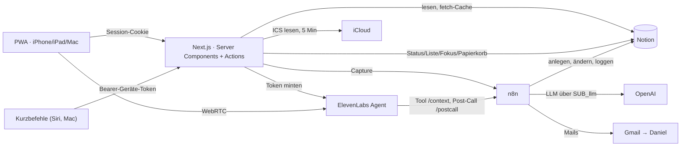

# Personal OS: Ist-Architektur

Stand 21.10.2026 · Geprüft am Code (`c09f285`), live in n8n, Notion und ElevenLabs (nur lesend).
Prioritäten und Status: [`ROADMAP.md`](ROADMAP.md). Planungsstand und Begründungen vom 12.10.:
[`../architecture/personal-os-blueprint.md`](../architecture/personal-os-blueprint.md).

**Belegstatus:** ✅ verifiziert (Code gelesen, Befehl ausgeführt oder live abgefragt) · 🔶 Annahme · 📊 Schätzung · ❓ offen

## 1. Verantwortung der Systeme

| System | Verantwortung | Grenze |
|---|---|---|
| **Notion** | Source of Truth für Aufgaben, Ziele, Digest, Wissen, Logs, Prompts, Konfiguration | Keine Logik. Schema-Änderungen nur mit Freigabe |
| **Next.js-App** (Vercel Hobby) | Oberfläche für iPhone, iPad, Mac. Liest Notion direkt, schreibt einfache Task-Änderungen direkt | Kein LLM, keine eigene Datenbank. Legt keine Aufgaben an (das macht n8n) |
| **n8n Cloud** | Alles mit Sprachverständnis oder Zeitplan: Capture, Digest, Post-Call, Hygiene, Lern-Schicht, Status-Kachel | Wird von der App nur für Capture aufgerufen (0 Ausführungen pro Seitenaufruf) ✅ |
| **ElevenLabs** | Voice-Agent „To-do Agent (Daily)“ | Ändert nichts selbst; Änderungen laufen über den Post-Call-Webhook nach n8n |
| **iCloud** | Kalender, nur lesend über öffentlichen ICS-Link | ADR [`0001`](../decisions/0001-icloud-kalender.md) |
| **Claude** | Bauen (dieses Repo) und wöchentliches Meta-Review (Routine, schreibt nach Notion „Meta-Reviews“) | Ändert n8n/Notion/ElevenLabs nur mit Freigabe |

## 2. App (Next.js 16, Cache Components)

### Routen ✅

| Route | Zweck | Daten | Zustand |
|---|---|---|---|
| `/` Today | Fokus (Top 3), Aufgaben-Tabs, Review-Modus, Capture, Assistant-Karte, Termine, Fortschritt, „Law“-Karte, Investments-Teaser | TODOS, Goals, iCloud | echt, außer Assistant-Karte (Link auf `/voice`) und Investments-Teaser (**Demo-Daten**) |
| `/tasks` | Spalten Heute / Diese Woche / Broader, Zeilenaktionen, Undo | TODOS, Goals | echt. „New task“ springt nach `/?capture=1` (verlässt die Seite) |
| `/calendar` | Tag/Woche, Refresh | iCloud ICS | echt |
| `/digest` | jüngste Digest-Ausgabe (Daily Brief, Markets & Money) + „For you“ aus Aufgaben | Digest Archive (3 Tage), TODOS | echt |
| `/discover` | Card-Feed Intelligence (7 Tage Digest) + Learning (24 Karten im Repo), „Relevant“-Feedback | Digest Archive (7 Tage), `content/learning` | echt; Feedback schreibt nur mit `DISCOVER_FEEDBACK_WRITE=true`, sonst Dry-Run |
| `/investments` | Platzhalter „Phase 4b“ | – | **nicht funktional** |
| `/voice` | Voice-Spike (Orb, Transkript, Diagnose) | ElevenLabs | Spike, siehe F7 |
| `/settings` | Theme, Integrationsstatus (nur „konfiguriert ja/nein“), Abmelden | Env | echt |
| `/api/capture` | Siri/Mac/App → n8n `D_todo_capture` | – | echt |
| `/api/voice/token` | Conversation-Token (Session + Origin-Check) | – | echt |
| `/api/discover/feedback` | „Relevant“ → Digest Feedback | – | echt (Dry-Run-Schalter) |
| `/api/health` | öffentlicher Minimalstatus | – | echt |

Navigation ✅: Sidebar 7 Einträge, iPhone-Tab-Bar **6 Tabs** (Today, Tasks, Calendar, Digest, Discover, Invest).
Das Design-Board (`design/personal-os.html`) sieht 5 vor; Discover kam am 14.10. dazu.

### Module und Nähte ✅

- `src/features/<modul>/` mit `types`, `store` (I/O, Mock/Notion-Schalter), `rules` (rein, getestet), `notion-map` (einzige Stelle
  für Property-Namen), `actions` (Server Actions über `authedAction`), `components`.
- Module: `tasks`, `today`, `capture`, `calendar`, `digest`, `discover`, `voice`, `shell`, `investments` (nur Mock).
- Gemeinsam: `lib/` (env, auth/session, action, notion, n8n, time, log, cache-tags), `components/ui/` (nur `Orb`, `icons`).
- Seiten-Gerüst: jede Page ruft `requireSession()` innerhalb `<Suspense>`; `npm run build` zeigt alle App-Routen als
  Partial Prerender (◐), `/api/*` dynamisch ✅ (Build 21.10.).
- Tests: 13 Dateien, 143 Unit-Tests grün ✅ (Regeln, Notion-Mapping mit echten API-Formen, Auth, Zeitzone, ICS, Discover).
  Kein E2E-Test, keine UI-Tests.

### Caching ✅

| Quelle | Mechanismus | TTL | Invalidierung |
|---|---|---|---|
| TODOS | `fetch`-Cache, Tag `tasks`, `listTasks` mit React `cache()` dedupliziert | 60 s | `updateTag` nach jeder Action, `revalidateTag` nach `/api/capture` |
| Goals (Chip-Titel) | `fetch`-Cache, Tag `goals` | 24 h | – |
| Digest Archive | `fetch`-Cache, Tag `digest`, **zwei verschiedene Abfragen** (Digest 3 Tage, Discover 7 Tage) | 15 / 30 min | – |
| iCloud | `unstable_cache` des geparsten Ergebnisses, 5-Minuten-Fenster im Schlüssel | 5 min | Refresh-Action |

Ungenutzt: Tag/TTL `status`, Env `REVALIDATE_SECRET`, öffentlicher Pfad `/api/hooks/` im Proxy ohne Route ✅.

### Sicherheit der App ✅

Passwort-Login (scrypt oder Klartext aus Env, konstante Vergleichszeit, 600 ms Bremse), JWT-Cookie 30 Tage (HS256,
`SESSION_VERSION` = überall abmelden), Proxy als optimistische Prüfung, zusätzlich Prüfung in jeder Page/Action/Route.
Geräte-Tokens für Siri als SHA-256-Hashes in `CAPTURE_TOKENS`. Security-Header in `next.config.ts` (keine CSP).
Secrets nur in `lib/env.ts` (server-only, Zod).

## 3. Datenquellen in Notion

| Datenbank | Data Source | Schreibt | Liest |
|---|---|---|---|
| TODOS | `b8065b38-…-e8708fc1b680` | App (Status, Liste, Prio, Fokus, Papierkorb), n8n Capture/Post-Call/`SUB_todos_apply`/Hygiene | App, `SUB_todos` |
| Goals | `467d56b3-…-08d47c443b7b` | Daniel | App (Chip), `B_news_digest` (Scoring, `Status = aktiv`) |
| Digest Archive | `42a6a120-…-f7d5002a2d11` | `B_news_digest` (2×/Tag, ≤ 8 Stories/Lauf) | App `/digest` + `/discover`, Digest-Dedupe |
| Digest Feedback | `dc9965a6-…-4d95894363ec` | `B_feedback` (Mail-Klicks, „Moves“), App „Relevant“ (Dry-Run per Default) | Digest-Scoring (60 Tage) |
| 🧠 Knowledge | `e699b992-…-fdf013a7a0fe` | `B_news_digest` (≤ 2 Konzepte/Lauf) | **niemand** ✅ (Feld „Zuletzt abgefragt“ in Stichproben leer) |
| Agent Log | `b3790be9-…-09d171cd1622` | `SUB_log` | `M_cockpit_status`, `M_improve`, Meta-Review |
| Agent Config, Prompts | `d62ed4d7-…`, `c768fdf4-…` | Daniel, **`M_improve` (nächtlich, ändert Prompts selbst)** | `SUB_config` |
| Kosten-Log / Kosten-Monate | – / `c665ca43-…` | `SUB_cost` | `M_cockpit_status` |
| Meta-Reviews (Seite) | – | Claude-Routine sonntags | Daniel |

Vollständige Property-Verträge: [`../notion-contract.md`](../notion-contract.md). Zustand des Daily-Calls liegt in der
n8n-Data-Table `pa_state` (nicht in Notion).

## 4. n8n (Cloud, Ordner „Personal AI Agent“)

16 aktive Workflows ✅. Einstiegspunkte:

| Workflow | Auslöser | Zweck |
|---|---|---|
| `D_todo_capture` | Webhook (Header-Auth) | Freitext → `SUB_llm` → 1–5 Aufgaben in TODOS |
| `D_daily_todo_call` | Webhooks `/status` (Header-Auth), `/context` (Schlüssel im If-Node), `/postcall` (**ohne Auth**) | Daily-Call: Liste für den Agenten, Transkript → LLM → Notion → Mail |
| `B_news_digest` | 08:00 und 17:00 | RSS + Economist → Clustering → Scoring (mit Goals, Feedback) → Redaktion → Mail → Archive + Knowledge |
| `B_feedback` | Webhook (signierte Mail-Links) | Klicks/Moves → Digest Feedback, Bestätigungsseite |
| `PA_orchestrator` | n8n-Chat + Webhook (Header-Auth) | AI-Agent mit Tools `todos_lesen/aendern`, `notion_suchen/lesen` |
| `C_todos_hygiene` | 06:40 | leere `Status`/`created_by` auffüllen |
| `M_improve` | 03:15 | Lern-Schicht: schreibt nächtlich eine Regel in `daily_call.aktionen` oder `orchestrator.system` |
| `M_cockpit_status` | stündlich 06–23 Uhr **und** nach jedem `SUB_log` | Status-Kachel in Notion neu schreiben |
| `ERR_notify` | Error-Trigger | Fehlermail + Agent-Log-Zeile |
| `SUB_*` | aufgerufen | `config`, `llm`, `todos`, `todos_apply`, `state`, `log`, `cost` |

**Last (21.10., 00:00–23:05 Berlin) ✅:** 70 Ausführungen, davon 26 als Einstieg (Trigger/Webhook) und 44 als
Sub-Workflow. `M_cockpit_status` allein: 25 (18 Zeitplan + 7 nach Log-Einträgen) = 36 % aller bzw. 69 % der
Einstiegs-Ausführungen. Ein Capture erzeugt 7 Ausführungen (`D_todo_capture`, `SUB_llm`, 2× `SUB_config`, `SUB_cost`,
`SUB_log`, `M_cockpit_status`). Kontingent laut Status-Kachel 2.500/Monat; ob Sub-Workflows zählen ❓.
📊 Hochgerechnet ≈ 780 (nur Einstiege) bis ≈ 2.100 (alle) Ausführungen/Monat, davon `M_cockpit_status` ≈ 540–750.

## 5. ElevenLabs (live geprüft 21.10.) ✅

Agent `agent_2601…`: `enable_auth: false`, Allowlist leer, `retention_days: 30`, `record_voice: true`, LLM `gpt-5.4-mini`,
10 Gespräche/Tag, 1 parallel. Tool `todos_abrufen` sendet Header `X-Key` aus der dynamischen Variable `zugang`; der Agent
hat dafür keinen Standardwert, und die App setzt sie nicht (`VoiceLab.tsx` ruft `startSession` ohne `dynamicVariables`).

## 6. Datenflüsse

| Fluss | Weg | Belege |
|---|---|---|
| Aufgaben lesen | RSC → `listTasks()` (1 Query pro Request, gepaged) → `deriveToday()` für Today, Tasks, Badge, Kopfzeile | ✅ Code |
| Aufgabe ändern (App) | `useOptimistic` → Server Action → `rules.ts` → `PATCH /pages/{id}` → `updateTag('tasks')` | ✅ Code |
| Aufgabe anlegen | App/Siri → `/api/capture` bzw. Action → n8n `/add` → `SUB_llm` → Notion | ✅ Code + Ausführungen |
| Aufgabe ändern (Voice) | Agent → `/context` (Snapshot je Gespräch) → Post-Call → LLM → eigener Code-Node in `D_daily_todo_call` → Notion → Mail | ✅ Workflow |
| Aufgabe ändern (Chat) | `PA_orchestrator` → `SUB_todos_apply` → Notion | ✅ Workflow |
| Kalender | RSC → `getCalendar()` → iCloud ICS (8 s, 5 MB) → `node-ical` → Cache | ✅ Code |
| Lesen | `B_news_digest` → Digest Archive → App `/digest` und `/discover` (zwei Abfragen, gleiche Daten) | ✅ |
| Wissen | `B_news_digest` → Knowledge → (kein Leser) | ✅ |
| Lernen | `today/laws.ts` (48 Titel, Today-Karte) · `content/learning/*.json` (24 Karten, alle `reviewed: false`) · Knowledge · „Dein Move heute“ in der Digest-Mail | ✅ vier getrennte Quellen |
| Status | Agent Log → `M_cockpit_status` → Notion-Kachel. Die App zeigt nur Konfigurationsstatus | ✅ |
| Wöchentliche Verbesserung | Claude-Routine sonntags → Notion „Meta-Reviews“ (KW41, KW42 vorhanden). Nur Agent-Leistung, keine persönliche Entwicklung | ✅ |

## 7. Befunde (Stand 21.10.)

IDs werden in `ROADMAP.md` referenziert.

| ID | Befund | Beleg |
|---|---|---|
| F1 | **Task-Logik dreifach:** `features/tasks/rules.ts`, `SUB_todos_apply` („Aktionen planen“) und `D_daily_todo_call` („Notion-Aktionen planen“, eigene Kopie, ruft `SUB_todos_apply` nicht auf). Die Kopien sind bereits auseinandergelaufen (Prio-Validierung, `datum`, Zuordnung per ID nur in `SUB_todos_apply`) | ✅ Workflow-JSON |
| F2 | **Fokus-Drift:** Die App setzt `Fokus = false`, wenn eine Aufgabe Heute verlässt; n8n-„verschieben“ nicht. Eine per Voice verschobene Top-3-Aufgabe bleibt in Top 3 und blockiert das 3er-Limit | ✅ Code beider Seiten (nicht live reproduziert) |
| F3 | **Top 3 per Voice geht verloren:** Agent-Prompt Schritt 5 „Lege mit Daniel die Top 3 fest“ und „alles Bestätigte wird eingetragen“, aber das Post-Call-Schema kennt keine Fokus-Aktion | ✅ Prompt + Schema |
| F4 | **Voice aus der App lädt die Liste vermutlich nicht:** `zugang` fehlt (Abschnitt 5), `/context` verlangt den Schlüssel. Mit der aktuellen Agent-Version (seit 12./13.10.) kein Gespräch mit Tool-Aufruf | ✅ Konfiguration · ❓ Live-Test fehlt |
| F5 | **Status-Kachel erzeugt die meiste n8n-Last** (Abschnitt 4). Zusätzlich hängt am Workflow eine ungeschützte, nirgends eingebundene HTML-Ansicht; deren Evening-Brief-Zeit (18:00) weicht von der Kachel (17:00) ab | ✅ |
| F6 | **Sicherheit offen:** Agent ohne Auth; `/postcall` ohne Signaturprüfung, Kosten-Zweig läuft vor jeder Prüfung; `/context`- und Mail-Link-Schlüssel stehen im Klartext in Workflow-Nodes | ✅ live |
| F7 | **Nicht funktionale Oberflächen:** Investments (Tab, Seite, Teaser mit Demo-Daten); Assistant-Karte auf Today ist nur ein Link auf die Spike-Seite `/voice` | ✅ |
| F8 | **Überlappende Oberflächen:** `/digest` und `/discover` zeigen dieselben Archive-Stories mit zwei Queries; „For you“ auf `/digest` wiederholt Today-Signale | ✅ |
| F9 | **Zu viele Tabs:** 6 in der iPhone-Tab-Bar | ✅ |
| F10 | **Lerninhalte aus vier Quellen** (Abschnitt 6), keine davon mit Rückmeldung oder Wiederholung; Knowledge ist reines Schreib-Archiv | ✅ |
| F11 | **Wenig UI-Bausteine:** `components/ui` hat nur Orb und Icons; 276 Inline-`style`-Objekte, 51 handgebaute Karten | ✅ grep |
| F12 | **HTML-Mails/Seiten fünffach in n8n gebaut** (Digest, Daily-Bestätigung, 12-Uhr-Erinnerung, Fehlermail, Feedback-Seite, plus Cockpit-Ansicht); Farbpalette aus `globals.css` kopiert und schon abgewichen (`#1d1d1f` vs. `--text #17191e`, Grün `#248a3d` vs. `#228239`) | ✅ |
| F13 | **Lern-Schicht ändert Prompts ohne neue Belege:** 7 Regeln in 7 Tagen, teils widersprüchlich, ohne neue Daily-Calls (Weekly Review KW42) | ✅ Review, 🔶 Ursache |
| F14 | **Frischer Clone: `npm run check` schlägt fehl** (`PageProps`/`LayoutProps` fehlen bis `next typegen`) | ✅ reproduziert |
| F15 | **Toter Code:** Action `setPriority` und `move` im Provider ohne UI, Tag `status`, `REVALIDATE_SECRET`, `/api/hooks/` | ✅ grep |
| F16 | **Keine Nutzungsdaten der App:** welche Seiten Daniel nutzt, ist unbekannt; das Weekly Review sieht nur n8n | ✅ |

### Prüfung der Altbefunde (aus dem früheren Architektur-Review)

| Altbefund | Ergebnis |
|---|---|
| Task-Logik in App, Sub-Workflow und Daily-Workflow dupliziert | **bestätigt** (F1), mit sichtbaren Folgen (F2, F3) |
| HTML-Mails in mehreren Workflows separat gebaut | **bestätigt** (F12) |
| Design-Styles zwischen App und Mail dupliziert | **bestätigt**, Werte bereits abgewichen (F12) |
| Mehrere Oberflächen zeigen überlappende Aufgaben/Wissen/Status | **bestätigt** für Lesen (F8) und Status (Notion-Kachel vs. Settings); Aufgaben sind sauber aus einer Liste abgeleitet |
| Übermäßige Hintergrundausführung für ein Notion-Status-Widget | **bestätigt** (F5) |
| Zu viele Tabs, nicht funktionale Demo-Inhalte | **bestätigt** (F7, F9) |
| Zu wenige wiederverwendbare UI-Komponenten | **bestätigt** (F11) |
| Inkonsistente Quellen für Lerninhalte | **bestätigt** (F10) |

## 8. Nutzung (14.–21.10., aus n8n und ElevenLabs) ✅

| Fähigkeit | Nutzung |
|---|---|
| Quick Capture | 13 Läufe (≈ 1,6/Tag), alle erfolgreich |
| Digest | 14/14 Läufe erfolgreich |
| Daily Call / Voice | 1 Gespräch (5 s, ohne Tool-Aufruf). Davor 10 Gespräche am 11.–13.10. (Aufbau) |
| Chat-Orchestrator | 0 |
| n8n-Fehler | 0 |

Folgerung 🔶: Der tägliche Kern ist Capture → Notion → Today/Tasks. Voice und Chat sind gebaut, aber nicht in Gebrauch.
Laut Weekly Review KW42 liegen Aufgaben bis zu 16 Tage auf „Heute“, `reschedule_count` ist überall leer, die
„3× verschoben“-Regel greift also nie.
